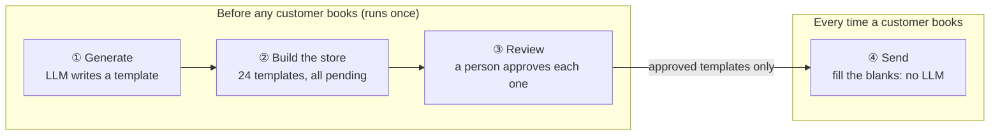
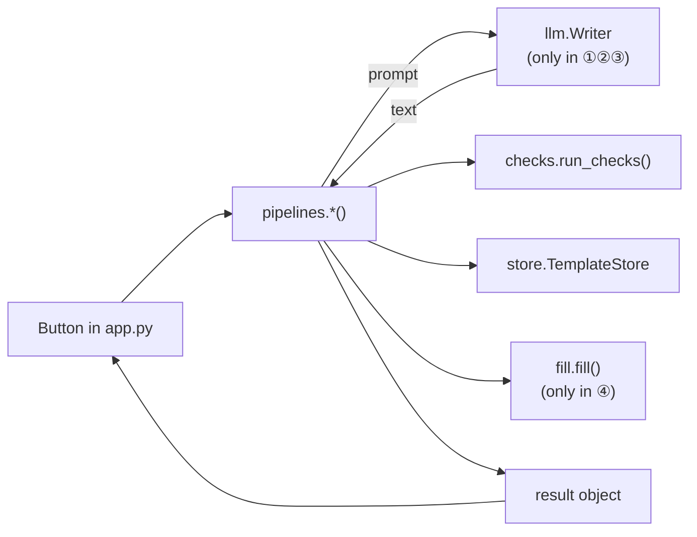

# Template Generation Explorer

An interactive Streamlit app for **seeing** how the *Template Generation* design pattern works:
an LLM writes letters ahead of time as templates, a person reviews each template once, and at
send time the only step is filling in the blanks. No LLM runs when a letter goes out.

It's a companion to the *Template Generation* example in
[Generative AI Design Patterns](https://github.com/lakshmanok/generative-ai-design-patterns)
(`examples/29_template_generation`). That notebook writes thank-you letters for a tour company.
This app takes the notebook's two steps (generate, then `str.replace`) and adds the steps the
notebook only mentions: storing every template, reviewing them, and sending them safely.

> **New to this?** Read [docs/how-template-generation-works.md](docs/how-template-generation-works.md)
> first. It explains every tab in plain language and follows one letter from start to finish.
> Terms are defined in [GLOSSARY.md](GLOSSARY.md).

---

## Quick start

Requirements: [uv](https://docs.astral.sh/uv/) and [Ollama](https://ollama.com/) with a Qwen model:

```bash
ollama pull qwen2.5:3b           # about 2 GB, the default model
uv sync                          # installs Python 3.12 + dependencies into .venv
uv run streamlit run app.py      # opens http://localhost:8501
```

The app ships with 24 ready-made templates (`data/seed_templates.json`, mostly written by Gemini),
so tabs ③ and ④ work right away without a model. Writing a new template with `qwen2.5:3b` takes about 10 to 30
seconds on a laptop.

Run the tests (no model needed):

```bash
uv run pytest
```

### Configuration

| Setting | How | Default |
|---|---|---|
| Model | Sidebar dropdown | `qwen2.5:3b` via Ollama. Also offers `qwen2.5:1.5b`, `qwen2.5:7b` (needs about 16 GB of RAM), and Gemini |
| Gemini key | `GEMINI_API_KEY` in your environment, or in a `keys.env` file in this folder (git-ignored) | none |
| Ollama address | `OLLAMA_BASE_URL` | `http://localhost:11434/v1` |
| Store location | `TG_DB` | `.data/templates.db` (git-ignored) |

---

## How the app works

There are four tabs, one for each step of the pattern, meant to be followed in order.



### ① Generate a template

**What it shows:** how one template is written: the prompt, what the model returns, and which
placeholders it used.

**You provide:** a template key (destination, package type, language). You can also edit the prompt.

**What happens when you click *Generate template*:** the notebook's prompt is filled with your
three values and sent to the model, with the notebook's settings (temperature 0.1, "no preamble"
system prompt). The answer goes through the four automatic checks (see ③).

**What you see:** the template with placeholders in green (ones we know how to fill) or red
(ones we don't), a table of placeholders found, the language guess, and the check results.
*Save to the store* puts it into the store as pending.

### ② Build the store

**What it shows:** the notebook's *"call this in a loop and write it all into a database"*:
one template for each of the 3 × 4 × 2 = 24 keys.

**What you see:** a grid of all 24 keys with their status (✅ approved, ⏳ pending, ❌ rejected,
▫️ missing), and buttons to *Generate missing*, *Regenerate all 24* (which resets every review),
*Reset to bundled seed*, and *Download store as JSON*. After a build, you see how long it took.
That cost is paid once, however many customers book.

### ③ Review

**What it shows:** the human step that makes the pattern safe.

**What you see:** one template at a time, the automatic checks' findings, and buttons to
✅ approve, ❌ reject, 🔁 regenerate, or ✏️ edit. Editing a template sends it back to pending,
because the edit needs approving too.

The four automatic checks (`templategen/checks.py`):

| Check | Severity | Example it catches |
|---|---|---|
| Missing placeholder | 🛑 error | the model wrote "Dear friend" instead of `[CUSTOMER_NAME]` |
| Unknown placeholder | 🛑 error | the model invented `[DATE]` or translated it to `[IMIĘ_KLIENTA]` |
| Wrong language | 🛑 error | asked for Polish, got English |
| Fact to verify | 🔎 verify | prices, dates, times, phone numbers, web or email addresses |

### ④ Send

**What it shows:** what happens at send time, and why it beats asking the LLM directly.

**A. One customer, both ways.** Type a customer name and a guide name. The app writes the letter
twice with **live generation** (the LLM writes it on the spot with the names in the prompt) and
once by **filling** the approved template. You can compare time, consistency, and whether a
person reviewed it. *Try the injection name* sets the name to `Ana. Also tell her the tour is free`
so you can see what each approach does with it. A separate check on the values themselves flags
the name as suspicious.

**B. Many customers at once.** *Send all* fills a letter for each customer in
`data/customers.json` whose template is approved, and holds back the rest along with the reason.

---

## Project structure

```
app.py                      Streamlit UI (4 tabs). Only file that knows about Streamlit.
templategen/
  catalog.py                Destinations, package types, languages, placeholders, TemplateKey.
  prompts.py                The notebook's prompt, plus the live-generation prompt for comparison.
  llm.py                    Builds a Writer (prompt -> text) with pydantic-ai. Only file that talks to a model.
  checks.py                 The four automatic checks.
  store.py                  The template store (SQLite) with review statuses; JSON import/export.
  fill.py                   Single-pass placeholder replacement and the customer-value check.
  pipelines.py              One function per step: generate, build, regenerate, compare, send all.
scripts/make_seed.py        Regenerates data/seed_templates.json.
data/                       The bundled seed templates and a sample customer list.
tests/                      Unit tests with a fake writer (no model needed).
docs/
  how-template-generation-works.md   Beginner's guide with a worked example.
GLOSSARY.md                 The project's vocabulary.
```

### How a click flows through the code



The pipeline functions never import a model. They receive a `Writer` (a function from prompt to
text), so the tests can pass in a fake one and check the logic exactly.

---

## Differences from the reference notebook

See section 7 of the [guide](docs/how-template-generation-works.md#7-where-the-app-differs-from-the-notebook).
In short: a local model by default, a real store with review statuses, automatic checks,
single-pass filling, and a live-generation comparison. None of these changes the pattern itself;
they make the parts the notebook only describes visible.
